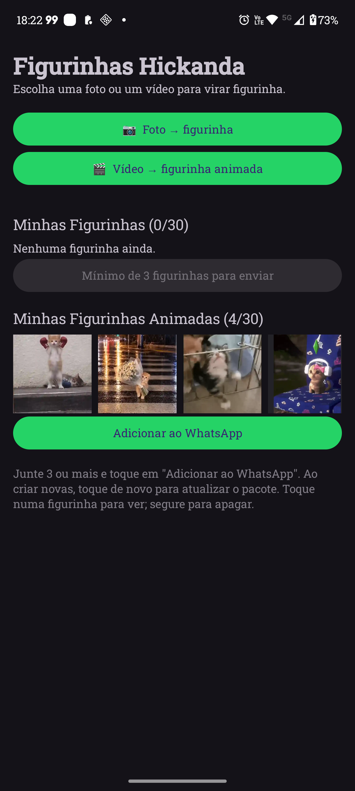
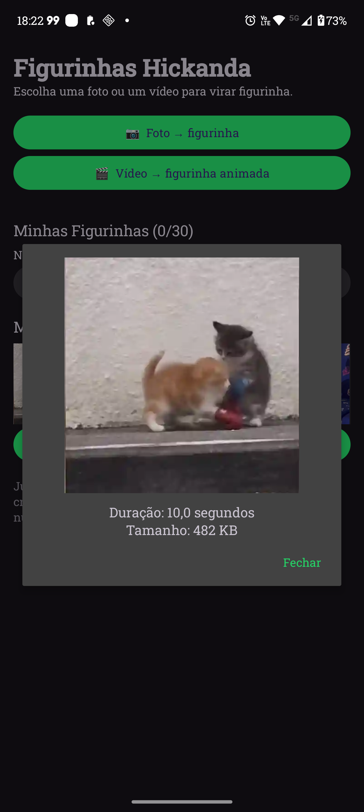

# Sticker App

App Android que transforma fotos e vídeos em figurinhas do WhatsApp, direto no celular.

## Prints

<p>
  
  
</p>

## Funcionalidades

- **Figurinhas estáticas** a partir de fotos, com tela de recorte antes da conversão.
- **Figurinhas animadas** a partir de vídeos e GIFs (até 10 segundos, 10 quadros por segundo).
- **Vários arquivos de uma vez**: escolha até 30 fotos ou vídeos e eles são convertidos em fila.
- **Compartilhar da galeria**: envie fotos/vídeos de outro app para o Sticker App pelo botão "Compartilhar".
- **Pré-visualização** com duração e tamanho; toque longo apaga a figurinha.
- **Adicionar ao WhatsApp** com um toque (WhatsApp e WhatsApp Business).

## Como funciona

| Arquivo | Responsabilidade |
|---|---|
| `MainActivity.kt` | Tela principal: escolher mídia, recortar, converter, listar e enviar pacotes |
| `StickerMaker.kt` | Converte fotos e vídeos para WebP 512×512 dentro dos limites do WhatsApp |
| `AnimatedWebpWriter.kt` | Monta o WebP animado juntando quadros (o Android só gera WebP estático) |
| `StickerStore.kt` | Guarda os dois pacotes (estáticas e animadas) na memória interna do app |
| `StickerContentProvider.kt` | Interface que o WhatsApp usa para ler os pacotes |

Limites exigidos pelo WhatsApp e respeitados pelo app:

- Estática: WebP 512×512, até 100 KB
- Animada: WebP animado 512×512, até 500 KB, no máximo 10 s
- Ícone da bandeja: PNG 96×96
- De 3 a 30 figurinhas por pacote; um pacote não pode misturar estáticas e animadas

Quando um vídeo não cabe em 500 KB, o app reduz a qualidade da imagem mantendo 10 quadros por
segundo; se ainda não couber, usa só o trecho inicial do vídeo, para a animação não ficar travada.

## Requisitos

- Android 9 (API 28) ou mais recente
- WhatsApp ou WhatsApp Business instalado

## Como compilar

Pelo Android Studio, abra a pasta do projeto e rode o módulo `app`.

Pela linha de comando é preciso um JDK 17+ e o Android SDK:

```bash
export JAVA_HOME=/caminho/para/jdk
export ANDROID_HOME=/caminho/para/Android/Sdk
./gradlew installDebug
```

No Windows, use `gradlew.bat installDebug`. Em vez de `ANDROID_HOME`, também dá para criar um
`local.properties` com `sdk.dir=...`.

## Tecnologias

Kotlin, AndroidX, Material Components e
[Android Image Cropper](https://github.com/CanHub/Android-Image-Cropper).
